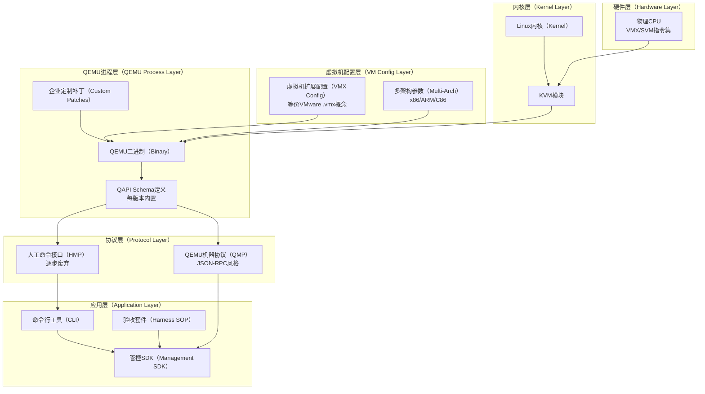
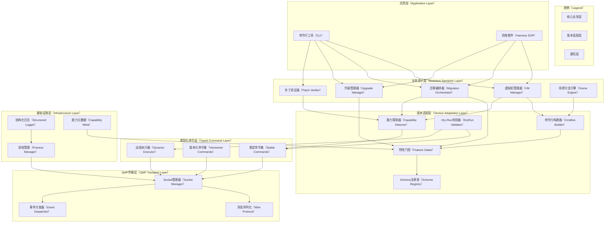
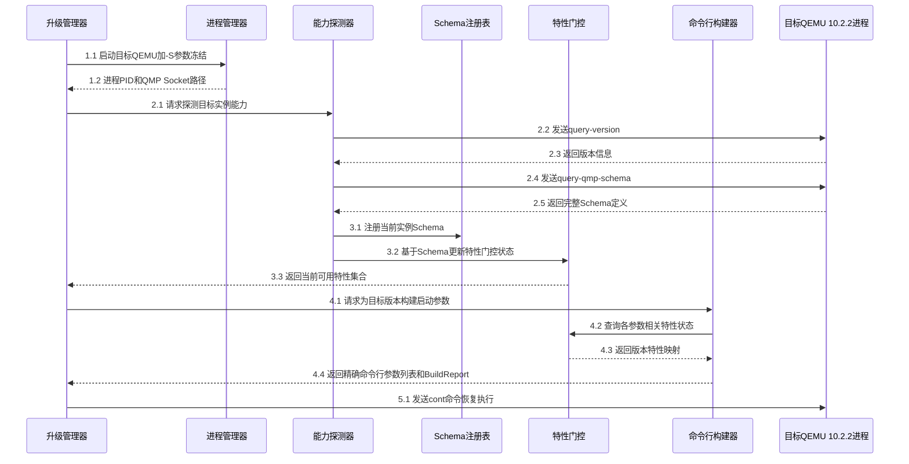
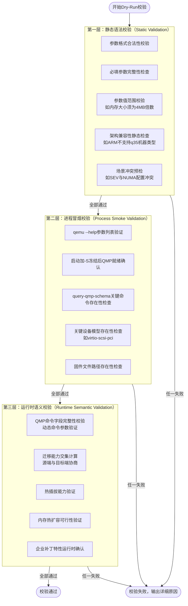
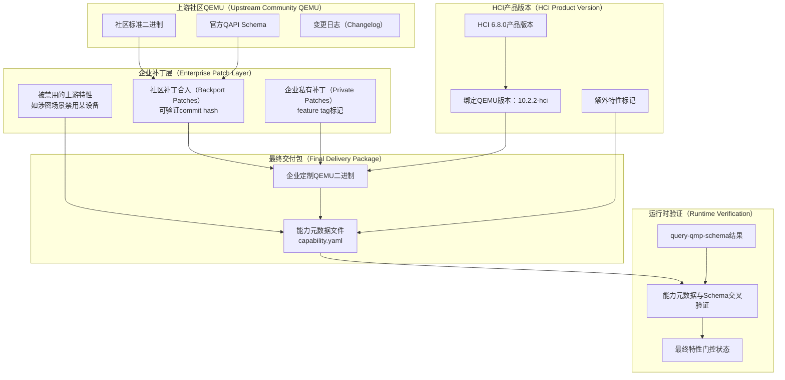
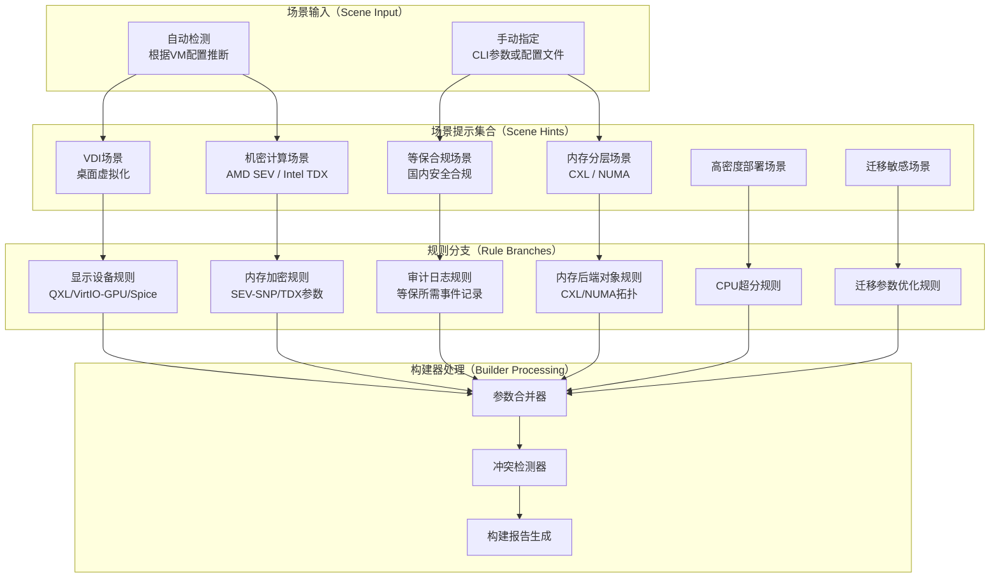
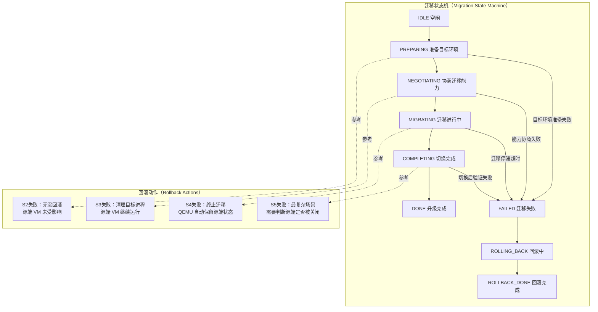

# 报告大纲

```text
第一章  需求精炼与意图重新锚定
  1.1  意图的本质与第一原则
  1.2  硬性约束的精炼与优先级排序
  1.3  隐含需求的显式化
  1.4  Proxmox 历史渊源的战略含义
  1.5  需求精炼后的完整约束清单

第二章  技术背景与生态现状评估
  2.1  虚拟化栈完整版本关系梳理
  2.2  热迁移机制的跨版本演进事实
  2.3  现有开源方案全景扫描与客观评估
  2.4  go-qemu 深度解析：可用资产与历史债务
  2.5  Proxmox PVE cfg2cmd 机制深度借鉴

第三章  多维度决策分析
  3.1  语言栈全面 ROI 对比（Go / Rust / Perl）
  3.2  类型化程度决策框架
  3.3  Dry-Run 层次决策
  3.4  开源整合策略决策
  3.5  最终决策矩阵与理由

第四章  整体系统架构设计
  4.1  分层架构总览与设计原则
  4.2  核心模块拆解
  4.3  版本适配机制详解
  4.4  Dry-Run 三层校验体系
  4.5  多架构适配设计
  4.6  企业定制补丁与原生 QEMU 分离模型
  4.7  场景分支引擎设计

第五章  核心数据结构与接口设计
  5.1  版本体系与 Feature Gates
  5.2  命令行构建器（Cmdline Builder）
  5.3  QMP 客户端分层接口
  5.4  Schema 模板化与代码生成体系
  5.5  迁移协商器核心接口

第六章  Harness SOP 完整设计
  6.1  SOP 设计原则与总体框架
  6.2  场景一：同机 QEMU 热升级（5.0 到 10.2.2）
  6.3  场景二：跨机热迁移（5.0 到 10.2.2）
  6.4  场景三：跨版本热迁移机制变化验证
  6.5  场景四：Full Cmdline Dump 与版本偏差 Warning
  6.6  场景五：热补丁更新后全场景验证
  6.7  场景六：历史版本 cfg2cmd 对比验证
  6.8  场景七：上层业务与 QEMU 层分层适配验证
  6.9  回滚机制标准流程

第七章  Put Them Together——端到端落地示例
  7.1  完整升级场景的代码调用链
  7.2  cfg2cmd 对比验证的实际输出示例
  7.3  版本 Cmdline Diff 报告示例

第八章  项目目录结构（详细完整版）

第九章  落地路线图

第十章  参考资料
```

---

# 第一章  需求精炼与意图重新锚定

## 1.1  意图的本质与第一原则

在正式展开任何设计之前，必须把这个系统的根本意图说清楚。表面上看，这是一个"管理 QEMU 进程的工具库"，但实际上，它要解决的是一个在 HCI 产品长期运营中持续出现的矛盾：QEMU 版本在不断演进，而运行在其上的虚拟机却不能停。

这个矛盾的核心在于：每一次 QEMU 升级，都意味着命令行参数的语义可能发生变化，QMP 协议的命令集合可能有所增减，热迁移的能力边界可能发生位移。如果没有一套系统性的机制来管理这些变化，每次升级都是一次风险赌博。

因此，整套系统的第一原则是：在任何 QEMU 版本组合下，都能精准构建出正确的命令行参数，并且能在问题发生之前（而非之后）发现参数错误或版本不兼容。这就是"始终围绕最终 QEMU 命令行参数的精准构建为第一原则"的具体含义。

Harness SOP 不是这套系统的附加物，而是它的兑现机制。一套没有 Harness 验收的设计，无论多么精妙，都只是纸面上的蓝图。Harness 让每一个设计决策都能被可重复地验证，让每一次 QEMU 升级都有明确的通过/失败判据。

## 1.2  硬性约束的精炼与优先级排序

对原始需求进行审视后，以下约束按优先级排序，高优先级约束不可被低优先级约束所牺牲：

第一优先级——不可妥协的边界条件：

* 无 libvirt，所有操作直接通过 QMP 和 QEMU 进程完成，这是环境事实，不是设计选择
* QEMU 5.0.0 到 10.2.2 的直接跨版本热迁移必须可行，这是当前已经明确的业务验收场景
* 虚拟机业务零中断是升级/迁移的强约束，不是软指标

第二优先级——必须满足的功能边界：

* 三层 Dry-Run 体系（静态校验、进程冒烟、QMP 运行时校验）缺一不可
* cfg2cmd 与历史 Perl 实现的等效性必须可验证
* HCI 企业定制补丁与原生 QEMU 能力必须有明确的分层管理

第三优先级——强烈推荐但有折中空间的设计目标：

* 分层类型化（稳定接口类型化，版本特定动态兜底）
* 场景分支引擎（VDI、机密计算、等保合规等）
* 多架构适配（x86、ARM、C86）

## 1.3  隐含需求的显式化

以下需求在原始描述中未被明确表达，但从上下文语境中可以明确推导，在此将其显式化：

系统必须是可编程的库，而非运维脚本。HCI 的上层编排服务需要通过 API 调用来驱动 QEMU，返回结构化的结果，而不是解析命令行输出或日志文件。

版本升级是常态运营事件，不是一次性迁移。HCI 产品会随时间持续升级 QEMU，这套系统必须能够低成本地支持每一次新版本的引入，理想情况下，引入新 QEMU 版本只需要更新版本矩阵配置和运行代码生成器，而不需要修改业务逻辑代码。

AI-friendly 架构意味着代码结构必须具备高度的可解释性。数据结构和接口的命名语义清晰，配置与逻辑分离，Schema 驱动而非硬编码。这样既方便人类维护，也使 AI 辅助生成和验证代码成为可能。在 2026 年的工程现实中，这一点已经不是加分项而是必要条件。

## 1.4  Proxmox 历史渊源的战略含义

HCI 管控面的 Proxmox PVE 渊源，是一个既是资产也是负债的历史事实。从资产角度看，Proxmox 的 `qemu-server` 模块经过十余年实战积累，其 cfg2cmd 逻辑中包含大量针对边缘情况的处理，这些知识是无价的测试基准。从负债角度看，这套 Perl 实现的 cfg2cmd 逻辑散布在数千行代码中，与 Proxmox 的其他逻辑强耦合，难以直接复用。

正确的战略定位是：将 Proxmox 的 cfg2cmd 逻辑作为行为规范（behavior specification）而非代码来源，通过 cfg2cmd diff 测试来验证新系统的等效性，而不是试图逐行翻译 Perl 代码。

## 1.5  需求精炼后的完整约束清单

经过以上分析，整理出完整的约束清单，供后续设计决策参照：

| 编号  | 约束类型 | 约束内容                              | 来源       |
| --- | ---- | --------------------------------- | -------- |
| C01 | 硬约束  | 无 libvirt，只通过 QMP 直连              | 环境事实     |
| C02 | 硬约束  | QEMU 5.0.0 直接迁移到 10.2.2，VM 业务零中断  | 明确验收场景   |
| C03 | 硬约束  | 跨版本热迁移能力必须协商，不能假设双端能力相同           | 技术事实     |
| C04 | 功能约束 | 三层 Dry-Run 缺一不可                   | 安全保障要求   |
| C05 | 功能约束 | cfg2cmd 与 PVE Perl 实现等效性可验证       | 历史兼容要求   |
| C06 | 功能约束 | HCI 企业补丁与社区 QEMU 能力分层管理           | 产品运营需求   |
| C07 | 功能约束 | 多架构支持：x86、ARM、C86                 | HCI 产品要求 |
| C08 | 功能约束 | 场景分支：VDI、机密计算、等保合规、内存分层           | 业务场景覆盖   |
| C09 | 设计约束 | AI-friendly 架构：语义清晰、配置驱动、Schema 化 | 长期可维护性   |
| C10 | 设计约束 | 引入新 QEMU 版本的边际成本要低                | 长期运营可持续  |

---

# 第二章  技术背景与生态现状评估

## 2.1  虚拟化栈完整版本关系梳理

理解版本兼容性问题的前提，是把整个虚拟化栈的依赖关系说清楚。这不是一条简单的线性链，而是一个多维度约束网格，任何一个层面的版本变化都可能对上下游产生连锁影响。



上图展示了各层之间的依赖关系。特别需要注意的是，VMX 配置在这里指的是虚拟机配置文件中的虚拟机扩展选项集合（类比 VMware 的 .vmx 文件概念），而不是 CPU 指令集层面的 VMX/SVM 扩展。这个配置决定了虚拟机暴露给客户操作系统的 CPU 特性集合，与 QEMU 的 `-cpu` 参数强耦合。

以下是各层版本关系的关键事实：

| 层级           | 关键版本节点                                                           | 对上层的实际影响                                                      |
| ------------ | ---------------------------------------------------------------- | ------------------------------------------------------------- |
| Linux Kernel | 4.14 LTS / 5.4 LTS / 5.15 LTS                                    | KVM ioctl API 稳定，但 KVM_CAP_DIRTY_LOG_RING 等新能力在 5.x 引入，影响迁移效率 |
| KVM 模块       | 随内核发布，通过 KVM ioctl 暴露能力                                          | QEMU 启动时通过 `/dev/kvm` 探测 KVM 能力，决定是否启用特定加速特性                  |
| QEMU Binary  | 5.0 blockdev 语义重构；6.0 废弃旧 -drive 写法；7.0 废弃多个 QMP 命令；8.x 引入更多迁移选项 | 命令行参数语义在大版本间不向后兼容，旧参数被标记废弃后通常保留 2-3 个大版本才删除                   |
| QAPI Schema  | 每个 QEMU 版本自带一份 Schema，5.0 后拆分为多文件                                | QMP 命令的字段由 Schema 精确定义，跨版本调用时必须运行时探测，不能静态假设                   |
| QMP 协议       | 协议本身自 2.x 以来格式稳定（JSON-RPC 2.0 风格），但命令集随 Schema 演进                | 命令的存在性和参数结构必须通过 query-qmp-schema 动态获取                         |

## 2.2  热迁移机制的跨版本演进事实

热迁移是本项目最复杂的场景，必须基于 QEMU 的实际行为来理解，而非凭经验推断。以下是可以从 QEMU 变更日志和 QAPI Schema 变化中查证的事实：

QEMU 5.x 的迁移体系：使用 `migrate` QMP 命令，通过 `migrate-set-capabilities` 配置能力列表，通过 `query-migrate-capabilities` 查询当前支持的能力。支持的能力包括 `xbzrle`、`rdma-pin-all`、`auto-converge`、`zero-blocks`、`compress`、`events`、`postcopy-ram`、`x-colo`、`release-ram`、`block`、`return-path`、`pause-before-switchover`、`late-block-activate`、`multifd`、`dirty-bitmaps` 等。

QEMU 7.x 引入的变化：`calc-dirty-rate` 命令作为新的脏页率估算工具被加入，迁移参数中 `max-bandwidth` 的单位含义有文档说明的变化。

QEMU 8.x 引入的变化：`postcopy-preempt` 作为新的迁移能力被加入，允许在 postcopy 阶段预取高优先级页面，减少故障处理延迟。

5.0 到 10.2.2 跨版本迁移的核心问题：源端（5.0）的能力集合是 10.2.2 能力集合的真子集。这意味着：不能在目标端启用源端不支持的能力，必须取能力交集。具体地，`postcopy-preempt` 在 5.0 不存在，如果目标端默认启用了它而不检查源端支持情况，迁移会失败。这是必须通过 MigrationNegotiator 进行能力协商的根本原因。

## 2.3  现有开源方案全景扫描与客观评估

以下评估基于各项目公开的 GitHub 仓库状态和文档，截至 2026 年的实际情况：

| 项目                      | 语言     | 活跃状态                 | QEMU 版本覆盖                | 核心价值                    | 致命缺陷                    |
| ----------------------- | ------ | -------------------- | ------------------------ | ----------------------- | ----------------------- |
| go-qemu [1]             | Go     | 趋于停滞                 | 2.x / 3.x 类型化，5.0+ 生成器失效 | 传输层质量高，事件系统设计好          | 类型层无法用于 5.0+            |
| qemu.qmp [2]            | Python | 活跃（官方树）              | 跟随最新 QEMU                | 最权威的动态实现，与 QEMU 源码同步    | 需要 Python 运行时，语言栈不符合    |
| qmp-rs [3]              | Rust   | 较活跃                  | 偏新版本                     | 动态 Rust 实现，类型安全的序列化     | 纯动态，版本覆盖历史积累不足          |
| qapi-rs [4]             | Rust   | passively maintained | 部分版本                     | 类型化 QAPI 绑定思路正确         | 维护不积极，版本矩阵不完整           |
| proxmox-qemu-server [5] | Perl   | 活跃（PVE 产品树）          | 持续跟进最新 QEMU              | cfg2cmd 实战积累最深，测试基准价值极高 | Perl 生态，强耦合 PVE 基础设施    |
| libvirt-go [6]          | Go     | 活跃                   | 通过 libvirt 间接            | 成熟稳定                    | 依赖 libvirt，与 C01 约束直接冲突 |

没有任何现成项目同时满足：Go 语言、5.0 到 10.x 全版本覆盖、类型化 API、无 libvirt 依赖。这一结论经过多方验证，是选择以现有项目为基础做整合自研的根本依据。

## 2.4  go-qemu 深度解析：可用资产与历史债务

go-qemu 项目的架构设计在概念上是正确的，它把传输层和命令层分离。问题在于它的代码生成器是在 QEMU 2.x 时代编写的，依赖 qapi schema 的早期单文件格式约定。

QEMU 5.0 对 qapi schema 进行了重大重构：schema 从单一的大文件拆分为按功能域组织的多文件（`qapi/block.json`、`qapi/migration.json`、`qapi/machine.json` 等）；引入了 `features` 字段用于标注特性可用性；枚举类型的语义描述方式有所变化；加入了条件编译指令（`if: { condition }`）。这些变化使得 go-qemu 的代码生成器在处理 5.0+ schema 时直接 abort 或 panic，这是一个已知的、未修复的问题。

可以复用的 go-qemu 资产：

* `qmp` 子包中的 socket 连接管理（Unix domain socket 和 TCP 均支持）
* JSON-RPC 消息的序列化/反序列化基础设施
* 事件订阅与分发机制（goroutine-based，设计合理）
* 连接重试和超时处理逻辑

必须放弃或重建的部分：

* `qemu` 子包中所有生成的类型定义（钉死 2.11）
* `qemu/internal/command` 目录下的生成代码
* schema 解析器（需要从头支持 5.0+ 多文件格式）
* 代码生成器主体

这意味着正确的策略是：fork go-qemu 的 `qmp` 传输层子包，将其作为网络通信的基础设施，然后在其上从零构建新的类型层和版本适配层。

## 2.5  Proxmox PVE cfg2cmd 机制深度借鉴

Proxmox 的 `PVE::QemuServer` 模块中的 cfg2cmd 逻辑，是本项目在功能等效性上最重要的参照基准。以下是从公开的 Proxmox 源码中可以观察到的关键设计模式：

Proxmox 使用一套基于配置键值对的映射机制，虚拟机配置文件（如 `cores: 4`、`memory: 8192`、`scsi0: local-lvm:vm-100-disk-0,size=50G`）通过一系列转换函数最终生成 QEMU 命令行参数列表。这个过程包含：

* 设备类型判断：根据配置的磁盘 bus 类型（ide/sata/scsi/virtio）选择不同的设备模型和控制器
* 版本感知逻辑：根据 `machine` 配置项的版本号，决定是否启用某些设备特性
* 格式兼容处理：旧式 `-drive` 参数和新式 `-blockdev` 参数的选择
* 特殊场景处理：Windows 客户机的时钟设置（`-rtc base=localtime`）、UEFI 固件路径等

这套逻辑的核心可以被提炼为一个规则引擎模式：输入是虚拟机配置（键值对），规则是"配置项到版本感知参数"的映射，输出是 QEMU 命令行参数列表。新系统应该将这个模式用更清晰的数据结构和更显式的版本控制来实现，而不是像 Proxmox 那样将版本判断散布在函数体的各处。

---

# 第三章  多维度决策分析

## 3.1  语言栈全面 ROI 对比

这个决策必须结合团队现状、生态成熟度、和现有代码关系来综合判断，而不能只看语言特性的抽象对比。

| 评估维度              | Go                    | Rust                             | Perl                        |
| ----------------- | --------------------- | -------------------------------- | --------------------------- |
| 与现有 Proxmox 代码的关系 | 需重写，接口清晰，行为通过测试验证     | 需重写，接口清晰                         | 可 fork 改造，但强耦合 PVE 基础设施难以解开 |
| 上手与持续维护成本         | 低，语言简单，并发模型直观         | 高，所有权模型持续消耗认知成本                  | 低初期，但类型系统缺失导致长期维护债务持续累积     |
| 类型安全保障            | 静态类型，编译期错误捕获          | 最高，内存安全编译期保障                     | 动态类型，运行时才发现类型错误             |
| QMP 异步事件处理        | goroutine 天然适合，代码简洁   | async/await 能力强，但异步 Rust 代码复杂度较高 | 事件驱动模型较弱，需借助外部事件循环          |
| 多架构交叉编译           | 原生支持，单一二进制，无运行时依赖     | 原生支持，无运行时依赖                      | 需要 Perl 解释器，部署环境依赖          |
| 代码生成器生态           | go generate 工具链成熟     | proc macro 强大但复杂                 | 代码生成能力弱                     |
| AI 辅助开发友好性        | 高，Go 代码简洁明确，AI 生成质量稳定 | 中，所有权约束导致 AI 生成代码频繁出错            | 中低，风格多样性导致 AI 生成代码质量不稳定     |
| 现有开源可复用资产         | go-qemu 传输层可直接复用      | qmp-rs 可参考，但整体需要较多自研             | PVE 代码路线成熟但强耦合              |
| 版本矩阵 CI 集成难度      | 低，Go 测试工具链完善          | 中，Cargo 体系完善但测试基础设施配置复杂          | 高，缺乏标准化测试框架                 |
| 长期 ROI 综合评估       | 最高                    | 中（长期性能好但初期和持续成本高）                | 最低（初期快但长期债务线性增长）            |

Perl 路线的根本问题不在于 Perl 语言本身的能力，而在于：HCI 这套系统的长期目标是建立一个可测试、可验证、可 CI 的版本管理基础设施。Perl 的动态类型和弱约束特性，在这个目标下的投入产出比是最低的。继续走 Perl 路线，等于在未来的每次 QEMU 升级中都需要靠人工审查来保证正确性，而不是靠测试。

Rust 路线在内存安全上的优势，在 QEMU 管理场景中并不能充分发挥价值——这个场景不是内存密集型或有极端延迟要求的场景。Rust 的优势（零成本抽象、内存安全、并发安全）在嵌入式、操作系统或高性能数据处理场景中才能获得最高回报。

结论：Go 是最优选择。

## 3.2  类型化程度决策框架

纯动态方案和纯类型化方案都有各自的极端问题。纯动态方案中，所有错误都在运行时暴露，而运行时错误的代价是虚拟机业务中断。纯类型化方案要求每个 QEMU 版本都有完整的 Go 类型绑定，维护成本随版本数量线性增长。

分层类型化是最合理的折中：

稳定核心命令使用类型化 API。这些命令包括：`query-version`、`query-qmp-schema`、`stop`、`cont`、`system_reset`、`migrate`、`query-migrate`、`migrate-set-capabilities`、`query-migrate-capabilities`、`migrate-set-parameters`。这些命令的接口在 QEMU 5.0 到 10.x 之间，字段集合的语义核心部分是稳定的，适合用类型化 API 封装。

版本敏感命令使用版本化类型化 API。例如 `blockdev-add` 的参数在不同版本间有字段增减，这类命令通过 Feature Gate 控制哪个版本启用哪套类型定义。

真正版本特定的命令使用动态 API 兜底，但必须在调用前通过 `query-qmp-schema` 验证字段存在性，确保在运行时捕获问题，而不是默默失败。

## 3.3  Dry-Run 层次决策

问题的核心在于：校验越早，代价越小。第一层静态校验（内存中计算，毫秒级）发现的问题，如果推迟到第三层运行时才发现，代价可能是一个进入迁移中途的虚拟机需要回滚。

三层都做是唯一正确答案：

* 第一层：不启动任何进程，纯内存计算，校验参数格式、必填项、架构兼容性
* 第二层：启动冻结态 QEMU（加 `-S` 参数），通过 QMP 验证设备模型存在性、关键命令可用性，然后销毁进程
* 第三层：在实际运行的 QEMU 实例上，通过 QMP 验证迁移能力、热插拔能力、运行时语义

## 3.4  开源整合策略决策

整合策略的核心思路是：选定一个基础 fork，将其他项目的关键能力按需融入，而不是试图把多个项目机械地拼在一起。

选定 go-qemu 的 `qmp` 传输层作为 fork 基础，理由是：这是所有候选方案中传输层实现质量最高、经过实际生产验证的部分。在此基础上，将以下其他项目的核心亮点融入：

* 从 Proxmox qemu-server 借鉴：cfg2cmd 规则引擎的设计模式，作为规则驱动构建器的概念参照
* 从 qemu.qmp（Python 官方实现）借鉴：schema 解析逻辑的正确性参照（Python 版本是官方的，逻辑可信度最高）
* 从 qapi-rs 借鉴：类型化 QAPI 绑定的代码生成思路，移植为 Go 版本

## 3.5  最终决策矩阵

| 决策点        | 选定方案                                    | 核心理由                                                |
| ---------- | --------------------------------------- | --------------------------------------------------- |
| 语言栈        | Go                                      | ROI 最高，goroutine 适合 QMP 异步，go-qemu 传输层可复用，AI 辅助开发友好 |
| 类型化程度      | 分层类型化                                   | 稳定接口类型化保安全，版本特定接口动态兜底保灵活，运行时 schema 校验兜底            |
| Dry-Run 层次 | 全三层                                     | 越早发现问题代价越小，三层共同构成完整的预防体系                            |
| 开源整合       | fork go-qemu 传输层，重建类型层和版本适配层，借鉴多个项目设计思路 | 最大化复用高质量资产，最小化维护负担                                  |
| Perl 路线    | 作为行为规范基准，不作为代码基础                        | Proxmox cfg2cmd 知识以测试基准形式保留，不走 Perl 代码路线            |

---

# 第四章  整体系统架构设计

## 4.1  分层架构总览与设计原则

整个系统分为六层，层间通过明确定义的接口交互，严禁跨层调用。这个约束不是教条，而是保证"上层业务逻辑对 QEMU 版本变化绝缘"这一核心目标的工程手段。



这个分层的核心价值在于：当 QEMU 从 10.2.2 升级到 12.x 时，只需要在版本适配层（Feature Gates、Schema Registry、Cmdline Builder 的规则集）中添加新版本的支持，业务语义层的代码不需要改动。这就是"引入新 QEMU 版本的边际成本低"这一设计目标的具体实现。

## 4.2  核心模块拆解

### 命令行构建器

命令行构建器是第一原则的直接实现。它的设计采用声明式规则引擎模式。虚拟机的配置（CPU、内存、磁盘、网络、机器类型等）被表达为与版本无关的中间表示（VMConfig IR），然后由构建器根据目标 QEMU 版本，将 IR 翻译为具体的命令行参数列表。

规则引擎包含三类规则：直接映射规则（配置项直接对应参数，跨版本语义相同）、版本条件规则（同一配置项在不同版本下对应不同参数）、废弃替换规则（旧参数在某版本后被废弃，需要用新参数替换）。每条规则的适用条件是精确的版本区间，而不是模糊的 if-else。

### 能力探测器

能力探测器是系统在运行时感知"当前 QEMU 实例实际上有哪些能力"的核心组件。它不依赖任何硬编码的版本假设，而是通过 `query-version` 和 `query-qmp-schema` 两个 QMP 命令，动态获取当前实例的精确能力集合，然后将结果注册到 Schema Registry 和 Feature Gates 中。

这一设计保证了即使 QEMU 被打了定制补丁（某个特性被 backport 或被禁用），系统也能正确感知，而不是依赖版本号来推断能力。

### 场景分支引擎

场景分支引擎使用 hints 机制，而不是 if-else 硬编码。每个场景对应一组 hints，hints 在命令行构建过程中激活对应的规则分支。这一设计的优势是场景可以叠加（例如一个 VDI 场景的虚拟机同时需要等保合规参数），而不需要为每个场景组合都写专门的代码。

## 4.3  版本适配机制详解

版本适配的工作流程分为探测、注册、查询三个阶段。以下时序图展示了一次完整的升级前版本适配过程：



这个流程的关键创新在于步骤 3.2：能力探测器不仅把 Schema 注册进去，还会用 Schema 来校正 Feature Gates 的状态。即使版本号表明某个特性应该存在，如果 Schema 中没有对应的命令或字段，Feature Gate 也会被标记为不可用。这一层保险是企业定制补丁环境下正确性的最终保障。

## 4.4  Dry-Run 三层校验体系



三层校验的设计原则是：越早发现问题，代价越小。第一层（毫秒级，无任何副作用）能发现的问题绝不推迟到第二层；第二层（秒级，需要启动一个临时进程）能发现的问题绝不推迟到第三层；第三层则是实际执行前的最终安全网。

## 4.5  多架构适配设计

x86、ARM、C86（兆芯）三个架构在 Feature Gates 层面需要独立管理。同版本的 QEMU 在不同架构下，支持的机器类型、固件选项、设备模型都存在差异。

```mermaid
graph TD
    subgraph ARCH_DETECT[架构探测层（Architecture Detection Layer）]
        HOST_ARCH[宿主机架构探测]
        GUEST_ARCH[客户机目标架构]
    end

    subgraph X86[x86架构规则（x86 Architecture Rules）]
        X86_MACH[机器类型：pc/q35]
        X86_FW[固件：SeaBIOS/OVMF]
        X86_CPU[CPU类型：host/Skylake/EPYC等]
        X86_VMX[VMX扩展配置（VMX Config）]
    end

    subgraph ARM[ARM架构规则（ARM Architecture Rules）]
        ARM_MACH[机器类型：virt]
        ARM_FW[固件：EDK2-ARM]
        ARM_CPU[CPU类型：host/cortex-a72等]
        ARM_PCI[PCI总线：gpex]
    end

    subgraph C86[兆芯架构规则（C86 Architecture Rules）]
        C86_MACH[机器类型：与x86相似<br>部分差异]
        C86_CPU[CPU类型：兆芯C86系列]
        C86_COMPAT[x86兼容层处理]
    end

    subgraph FGATE[特性门控（Feature Gates）]
        ARCH_GATE[架构特定门控]
    end

    HOST_ARCH --> ARCH_GATE
    GUEST_ARCH --> ARCH_GATE
    X86_MACH --> ARCH_GATE
    X86_FW --> ARCH_GATE
    X86_CPU --> ARCH_GATE
    X86_VMX --> ARCH_GATE
    ARM_MACH --> ARCH_GATE
    ARM_FW --> ARCH_GATE
    ARM_CPU --> ARCH_GATE
    ARM_PCI --> ARCH_GATE
    C86_MACH --> ARCH_GATE
    C86_CPU --> ARCH_GATE
    C86_COMPAT --> ARCH_GATE
```



C86（兆芯）架构的特殊性值得单独说明：兆芯处理器在指令集层面与 x86 高度兼容，但在某些 QEMU 设备模型的实际行为上与标准 x86 存在差异，这些差异需要通过运行时测试来发现和记录，而不能完全依赖文档推断。架构特定规则库的初始数据，需要通过实际测试矩阵来验证和填充。

## 4.6  企业定制补丁与原生 QEMU 分离模型

这个设计点的重要性经常被低估。当系统基于版本号来推断能力时，一旦 QEMU 被打了企业定制补丁（某个特性被 backport 到低版本，或某个特性被禁用），系统的推断就会出错。能力元数据文件（`capability.yaml`）是解决这个问题的关键机制。



`capability.yaml` 的设计让企业能够精确声明"当前交付的 QEMU 与社区标准版本有哪些差异"，让系统能够在运行时通过交叉验证来确认实际的能力状态，而不是盲目相信版本号的推断。

## 4.7  场景分支引擎设计

场景分支引擎的设计核心是 hints 叠加机制。不同场景的 hints 可以同时激活，构建器会处理来自多个场景的规则并检测冲突。



冲突检测器是这个机制的质量保障。SEV 内存加密场景与内存分层（CXL）场景在某些 QEMU 版本下存在约束冲突，冲突检测器负责提前发现这类问题并给出明确的错误信息，防止生成无效的命令行。

---

# 第五章  核心数据结构与接口设计

## 5.1  版本体系与 Feature Gates

```text
// QEMUVersion 表示一个具体的 QEMU 版本，包含企业定制信息
type QEMUVersion struct {
    Major   int
    Minor   int
    Micro   int
    HCITag  string      // 例如 "hci-6.8.0"，空字符串表示社区版本
    Patches []PatchMeta // 记录已合入的补丁元数据
}

// PatchMeta 描述单个补丁的元数据
// CommitHash 对社区补丁有效，FeatureTag 对企业私有补丁有效
type PatchMeta struct {
    CommitHash string // 社区补丁的 git commit hash（可验证）
    FeatureTag string // 企业私有补丁的功能标签（不暴露实现）
    Source     PatchSource
}

// FeatureGate 定义一个特性的完整生命周期信息
type FeatureGate struct {
    Name        string
    Description string
    Available   VersionRange // 该特性的可用版本区间
    Deprecated  *QEMUVersion // 废弃起始版本，nil 表示未废弃
    Removed     *QEMUVersion // 删除起始版本，nil 表示未删除
    DependsOn   []string     // 依赖的其他特性名称
    Arches      []Arch       // 可用架构列表，nil 表示全架构可用
    // SchemaKey 是 query-qmp-schema 中对应的命令或类型名称
    // 用于运行时交叉验证
    SchemaKey   string
}

// FeatureGateRegistry 管理所有特性的版本状态
// 这是版本适配层的核心状态容器
type FeatureGateRegistry struct {
    gates       map[string]*FeatureGate
    currentVer  QEMUVersion
    currentArch Arch
    schema      *QAPISchema
    capMeta     *CapabilityMeta
}

// IsEnabled 查询一个特性在当前版本+架构+schema 下是否可用
// 三重验证：版本区间 + 架构兼容 + schema 运行时确认
func (r *FeatureGateRegistry) IsEnabled(name string) (bool, Reason, error)

// VersionRange 表示一个闭开区间 [From, To)
type VersionRange struct {
    From QEMUVersion // 包含（闭区间）
    To   *QEMUVersion // 不包含（开区间），nil 表示无上限
}

// Arch 枚举可用架构
type Arch string

const (
    ArchX86  Arch = "x86_64"
    ArchARM  Arch = "aarch64"
    ArchC86  Arch = "c86_64"   // 兆芯架构标识
)
```

## 5.2  命令行构建器

```text
// VMConfig 是虚拟机配置的中间表示（IR）
// 与任何具体的 QEMU 版本无关，是配置的语义表达
type VMConfig struct {
    VMID    int
    Name    string
    CPU     CPUConfig
    Memory  MemoryConfig
    Machine MachineConfig
    Disks   []DiskConfig
    NICs    []NICConfig
    Display DisplayConfig
    VMX     VMXConfig    // 虚拟机扩展配置，等价于 VMware .vmx 概念
    Extras  []ExtraArg  // 透传原始参数，作为逃生通道
}

// VMXConfig 虚拟机扩展配置
// 控制虚拟机暴露给客户操作系统的 CPU 特性集合
type VMXConfig struct {
    NestedVirt bool              // 嵌套虚拟化开关
    CPUFeatures []string         // 显式启用的 CPU 特性
    CPUForbidden []string        // 显式禁用的 CPU 特性
    MachineType string           // 强制指定 machine type 版本
}

// CmdlineBuilder 版本感知的命令行参数构建器
type CmdlineBuilder struct {
    registry *FeatureGateRegistry
    hints    SceneHints
    rules    []BuildRule
    version  QEMUVersion
    arch     Arch
}

// NewBuilder 通过函数式选项创建构建器实例
func NewBuilder(opts ...Option) (*CmdlineBuilder, error)

// WithOption 系列 — 函数式选项接口
type Option func(*CmdlineBuilder) error

func WithQEMUVersion(v QEMUVersion) Option
func WithArch(a Arch) Option
func WithScene(hints SceneHints) Option
func WithHCIVersion(v string) Option
func WithCapabilityMeta(meta *CapabilityMeta) Option
func WithExtraRules(rules ...BuildRule) Option

// Build 执行构建，返回参数列表和详细的构建报告
// BuildReport 是实现 dry-run 和版本 diff warning 的核心数据
func (b *CmdlineBuilder) Build(cfg *VMConfig) ([]string, *BuildReport, error)

// BuildReport 记录命令行构建的完整决策链
type BuildReport struct {
    QEMUVersion QEMUVersion
    Arch        Arch
    Hints       SceneHints
    Args        []ArgEntry
    Warnings    []Warning
    Errors      []BuildError
}

// DiffFrom 计算与另一个版本相比的参数变化
func (r *BuildReport) DiffFrom(otherVersion QEMUVersion, otherReport *BuildReport) *CmdlineDiff

// ArgEntry 记录单个参数的完整来源链
type ArgEntry struct {
    Key         string
    Value       string
    RuleName    string   // 产生此参数的规则名称
    FeatureGate string   // 相关联的特性门控
    Reason      string   // 人类可读的决策理由
    Deprecated  bool     // 此参数是否为废弃参数
}

// BuildRule 是规则引擎的核心接口
// 每类设备参数的构建逻辑实现这个接口
type BuildRule interface {
    Name() string
    // Applies 判断此规则是否适用于当前配置+版本+场景组合
    Applies(cfg *VMConfig, version QEMUVersion, arch Arch, hints SceneHints) bool
    // Apply 执行构建，返回此规则产生的参数条目
    Apply(cfg *VMConfig, version QEMUVersion) ([]ArgEntry, error)
    // Conflicts 声明此规则与哪些其他规则存在潜在冲突
    Conflicts() []string
}
```

## 5.3  QMP 客户端分层接口

```text
// Transport 是 QMP 传输层的底层接口（来自 go-qemu fork）
// 只负责消息的收发，不关心语义
type Transport interface {
    Send(msg []byte) error
    Receive() ([]byte, error)
    Close() error
}

// Client 是 QMP 客户端的完整接口
// 分为三个层次：连接管理、类型化稳定命令、动态执行
type Client interface {
    // 连接管理
    Connect(ctx context.Context) error
    Close() error
    IsConnected() bool

    // 类型化稳定命令 — 这些命令在 5.0~10.x 语义核心稳定
    QueryVersion(ctx context.Context) (*VersionInfo, error)
    QueryQMPSchema(ctx context.Context) (*QAPISchema, error)
    QueryMigrateCapabilities(ctx context.Context) ([]MigrateCapability, error)
    SetMigrateCapabilities(ctx context.Context, caps []MigrateCapability) error
    QueryMigrateParameters(ctx context.Context) (*MigrateParameters, error)
    SetMigrateParameters(ctx context.Context, params *MigrateParameters) error
    Migrate(ctx context.Context, uri string) error
    QueryMigrate(ctx context.Context) (*MigrationInfo, error)
    Stop(ctx context.Context) error
    Resume(ctx context.Context) error
    SystemReset(ctx context.Context) error
    Quit(ctx context.Context) error

    // 动态命令执行 — 兜底路径，带运行时 schema 校验
    Execute(ctx context.Context, cmd string, args interface{}) (json.RawMessage, error)
    // ExecuteChecked 在执行前先通过 schema 验证命令和参数的合法性
    ExecuteChecked(ctx context.Context, cmd string, args interface{}, schema *QAPISchema) (json.RawMessage, error)

    // 事件订阅
    Subscribe(ctx context.Context, eventType string) (<-chan Event, func(), error)
}

// MigrationNegotiator 跨版本迁移能力协商器
// 这是解决 5.0 到 10.2.2 跨版本热迁移兼容性的核心组件
type MigrationNegotiator struct {
    srcClient Client
    dstClient Client
}

// Negotiate 计算源端和目标端的迁移能力交集
// 并将双方都配置为使用交集能力集合
// 返回协商后的能力集合，供上层记录和审计
func (n *MigrationNegotiator) Negotiate(ctx context.Context) (*NegotiatedCapabilitySet, error)

// NegotiatedCapabilitySet 记录协商结果
type NegotiatedCapabilitySet struct {
    SrcCaps      []MigrateCapability   // 源端原始能力集合
    DstCaps      []MigrateCapability   // 目标端原始能力集合
    Intersection []MigrateCapability   // 协商后的交集
    Disabled     []string              // 被协商禁用的能力（目标有但源无）
}
```

## 5.4  Schema 模板化与代码生成体系

Schema 代码生成器是解决 go-qemu 历史债务的关键。新生成器必须支持 QEMU 5.0+ 的多文件 qapi schema 格式，处理 `features` 字段和条件编译指令，并为生成的每个类型标注版本起始信息。

```text
// 代码生成器的使用方式（通过 go generate 或 Makefile 调用）
//
// 生成 QEMU 5.0.0 的类型绑定：
//   qapi-gen \
//     --schema-dir ./schemas/qemu-5.0.0/qapi \
//     --out-dir ./internal/gen/v5 \
//     --version 5.0.0 \
//     --package gen_v5
//
// 生成 QEMU 10.2.2 的类型绑定：
//   qapi-gen \
//     --schema-dir ./schemas/qemu-10.2.2/qapi \
//     --out-dir ./internal/gen/v10 \
//     --version 10.2.2 \
//     --package gen_v10
//
// 生成器产出的文件结构：
//   internal/gen/v5/
//     types_gen.go       -- QAPI 类型定义（struct/enum）
//     commands_gen.go    -- QMP 命令的 Go 函数绑定
//     schema_meta_gen.go -- Schema 元数据（版本、命令列表）
//
// 每个生成的类型带有版本注释，例如：
//
// MigrateCapability 对应 QAPI migrate-capability 枚举
// QEMU 5.0.0 起可用
// postcopy-preempt 字段在 QEMU 8.x 引入，见 SchemaKey 说明
type MigrateCapability struct {
    Capability string `json:"capability"`
    State      bool   `json:"state"`
}
```

## 5.5  Capability 元数据格式

```text
// capability.yaml 文件格式示例
// 随每个 HCI 产品版本的 QEMU 包一起发布
//
// ---
// qemu_base_version: "10.2.2"
// hci_version: "hci-6.8.0"
// build_date: "2026-03-15"
//
// backported_patches:
//   - commit_hash: "abc123def456"
//     description: "migration: fix postcopy-preempt edge case"
//     upstream_version: "10.3.0"
//
// private_patches:
//   - feature_tag: "hci-cxl-memory-tier-v2"
//     description: "CXL内存分层支持扩展"
//   - feature_tag: "hci-c86-cpu-compat"
//     description: "兆芯C86 CPU兼容层"
//
// disabled_upstream_features:
//   - name: "x-colo"
//     reason: "等保合规要求禁用COLO复制功能"
//
// verified_arches:
//   - x86_64
//   - aarch64
//   - c86_64
```

---

# 第六章  Harness SOP 完整设计

## 6.1  SOP 设计原则与总体框架

Harness SOP 的设计原则是：每个验收场景都必须是自包含的、可重复执行的、结果明确的（通过/失败，无模糊中间态）。每个场景都包含：前置条件检查、执行步骤、验证步骤、清理步骤、以及失败时的回滚步骤。

```text
graph TD
    subgraph PREP[阶段一：环境准备（Environment Preparation）]
        P1[1.1 宿主机环境校验<br>KVM可用性/CPU特性]
        P2[1.2 QEMU二进制版本确认<br>含capability.yaml读取]
        P3[1.3 网络和存储预检<br>迁移通道可达性]
        P4[1.4 基线VM启动与稳定性确认<br>业务流量建立]
        P1 --> P2 --> P3 --> P4
    end

    subgraph EXEC[阶段二：场景执行（Scenario Execution）]
        E1[2.1 第一层Dry-Run：静态校验]
        E2[2.2 第二层Dry-Run：进程冒烟]
        E3[2.3 第三层Dry-Run：QMP运行时校验]
        E4[2.4 执行目标场景动作]
        E1 --> E2 --> E3 --> E4
    end

    subgraph VERIFY[阶段三：结果验证（Result Verification）]
        V1[3.1 业务连通性验证<br>VM网络/服务可达]
        V2[3.2 VM状态一致性检查<br>CPU/内存/磁盘状态]
        V3[3.3 QEMU进程状态确认<br>版本/QMP可用]
        V4[3.4 命令行参数Diff报告生成]
        V1 --> V2 --> V3 --> V4
    end

    subgraph ROLLBACK[回滚路径（Rollback Path）]
        R1[回滚触发条件评估<br>自动vs手动]
        R2[源端VM状态恢复确认]
        R3[旧版本QEMU进程状态确认]
        R4[目标端进程清理]
        R5[业务连通性重新验证]
        R1 --> R2 --> R3 --> R4 --> R5
    end

    subgraph CLEANUP[阶段四：清理（Cleanup）]
        C1[临时进程终止]
        C2[临时文件清理]
        C3[测试报告输出]
    end

    PREP --> EXEC
    EXEC --> VERIFY
    EXEC -- 任意步骤失败 --> ROLLBACK
    VERIFY -- 验证失败 --> ROLLBACK
    VERIFY --> CLEANUP
    ROLLBACK --> CLEANUP
```

## 6.2  场景一：同机 QEMU 热升级（5.0 到 10.2.2）

前置条件：

* 宿主机上同时安装了 QEMU 5.0.0 和 QEMU 10.2.2 二进制
* 目标 VM 处于运行状态，业务流量持续
* QEMU 10.2.2 的 capability.yaml 文件可读取

执行步骤（对应 CLI 命令）：

```text
# 步骤 1：完整 Dry-Run 校验
qvm dry-run full \
  --vm-config /etc/hci/vms/100.conf \
  --source-qemu /usr/bin/qemu-5.0.0 \
  --target-qemu /usr/bin/qemu-10.2.2 \
  --capability-meta /etc/hci/capability/10.2.2-hci-6.8.yaml

# 步骤 2：生成并对比命令行 Diff（供人工审核）
qvm cmdline diff \
  --vm-config /etc/hci/vms/100.conf \
  --from-version 5.0.0 \
  --to-version 10.2.2

# 步骤 3：执行同机热升级
qvm upgrade local \
  --vmid 100 \
  --target-qemu /usr/bin/qemu-10.2.2 \
  --on-failure rollback \
  --rollback-timeout 60s

# 步骤 4：验证业务状态
qvm verify \
  --vmid 100 \
  --checks version,network,disk,qmp-health
```

验收标准：

* VM 的业务流量在整个升级过程中持续可达（允许迁移切换时的短暂中断，一般在毫秒级）
* 升级完成后 `qvm verify` 全部通过
* `qvm cmdline diff` 报告中的所有差异都有明确的规则说明，无"未知来源"差异

回滚触发条件：

* Dry-Run 任意层失败
* 迁移启动后 60 秒内未完成且停滞
* 迁移完成但 `qvm verify` 失败

## 6.3  场景二：跨机热迁移（5.0 到 10.2.2）

前置条件：

* 源宿主机 A 运行 QEMU 5.0.0
* 目标宿主机 B 已安装 QEMU 10.2.2
* 两台宿主机之间网络可达，迁移带宽充足
* 目标宿主机 B 上已准备好等效的存储和网络配置

执行步骤：

```text
# 步骤 1：目标宿主机环境预检
qvm prepare-destination \
  --target-host 192.168.1.2 \
  --vmid 100 \
  --source-config /etc/hci/vms/100.conf \
  --target-qemu /usr/bin/qemu-10.2.2

# 步骤 2：Dry-Run 校验（在目标宿主机上执行）
qvm dry-run full \
  --vm-config /etc/hci/vms/100.conf \
  --target-qemu /usr/bin/qemu-10.2.2 \
  --remote-host 192.168.1.2

# 步骤 3：迁移能力协商预览（不执行，只输出协商结果）
qvm migrate negotiate-preview \
  --source-vmid 100 \
  --source-host 192.168.1.1 \
  --dest-host 192.168.1.2

# 步骤 4：执行跨机迁移
qvm migrate cross-host \
  --vmid 100 \
  --source-host 192.168.1.1 \
  --dest-host 192.168.1.2 \
  --dest-qemu /usr/bin/qemu-10.2.2 \
  --on-failure rollback

# 步骤 5：迁移完成后验证
qvm verify --vmid 100 --host 192.168.1.2 \
  --checks version,network,disk,qmp-health
```

## 6.4  场景三：跨版本热迁移机制变化验证

这个场景专门验证不同 QEMU 版本下热迁移机制差异的正确处理。它不是一个端到端业务场景，而是一个专项技术验证场景。

```text
# 查询源端（5.0.0）的迁移能力集合
qvm migrate capabilities \
  --vmid 100 \
  --host 192.168.1.1

# 查询目标端（10.2.2）的迁移能力集合
qvm migrate capabilities \
  --qemu-binary /usr/bin/qemu-10.2.2 \
  --vm-config /etc/hci/vms/100.conf \
  --dry-start

# 计算并输出能力交集（不执行迁移）
qvm migrate capability-intersection \
  --source-vmid 100 --source-host 192.168.1.1 \
  --dest-qemu /usr/bin/qemu-10.2.2

# 预期输出示例：
# === 迁移能力协商结果 ===
# 源端版本：QEMU 5.0.0
# 目标端版本：QEMU 10.2.2
#
# [源端有，目标端有，将启用]
#   xbzrle: true
#   auto-converge: true
#   multifd: false（源端支持但目标端有更新版本约束）
#
# [目标端有，源端无，将禁用]
#   postcopy-preempt: 禁用（QEMU 8.x 引入，源端 5.0 不支持）
#
# [协商后最终启用的能力列表]
#   xbzrle, auto-converge, events, late-block-activate
```

## 6.5  场景四：Full Cmdline Dump 与版本偏差 Warning

```text
# 完整命令行 Dump（当前运行版本）
qvm cmdline dump \
  --vmid 100 \
  --format pretty

# 当前版本与上一个已知良好版本对比
qvm cmdline diff \
  --vmid 100 \
  --from-version 5.0.0 \
  --to-version 10.2.2 \
  --warn-deprecated \
  --warn-behavior-change

# 预期输出包含以下类型的警告：
# [DEPRECATED WARNING]
#   参数 -drive file=...,cache=writeback 在 QEMU 7.0 后已废弃
#   建议：迁移到 -blockdev driver=raw,cache.writeback=on,...
#   当前处理：已自动转换为等效的新式参数（见上方参数列表）
#
# [BEHAVIOR CHANGE WARNING]
#   -machine 版本从 pc-i440fx-5.0 变更为 pc-i440fx-10.2
#   影响：某些设备的默认行为可能发生变化
#   建议：在测试环境验证 Windows 客户机时钟行为
```

## 6.6  场景五：热补丁更新后全场景验证

这个场景覆盖 QEMU 10.2.2 发布安全热补丁后，在不重启虚拟机的情况下，验证补丁前后所有功能的一致性。

```text
# 记录补丁前的基线状态
qvm patch baseline \
  --vmid 100 \
  --output /tmp/baseline-before-patch.json

# 更新 QEMU 二进制（补丁后）
# 此步骤由 HCI 运维流程完成，qvm 不直接干预

# 补丁后全量验证
qvm patch verify \
  --vmid 100 \
  --baseline /tmp/baseline-before-patch.json \
  --new-qemu-binary /usr/bin/qemu-10.2.2-patch1 \
  --new-capability-meta /etc/hci/capability/10.2.2-patch1-hci-6.8.yaml \
  --checks schema-diff,feature-gates,cmdline-stability,migrate-caps

# 验证项说明：
# schema-diff：对比补丁前后 query-qmp-schema 的结果差异
# feature-gates：验证特性门控状态无意外变化
# cmdline-stability：验证命令行参数构建结果与基线一致
# migrate-caps：验证迁移能力集合无意外减少
```

## 6.7  场景六：历史版本 cfg2cmd 对比验证

这是 HCI 历史 Perl 实现与新 Go 实现之间等效性的专项验证场景。

```text
# 对指定 VM 配置执行双实现对比
qvm cfg2cmd diff \
  --config /etc/hci/vms/100.conf \
  --perl-qm /usr/sbin/qm \
  --qemu-version 5.0.0 \
  --ignore-order \
  --known-equivalents /etc/hci/cfg2cmd-equivalents.yaml

# 批量对比当前所有 VM 配置
qvm cfg2cmd diff-all \
  --config-dir /etc/hci/vms/ \
  --perl-qm /usr/sbin/qm \
  --qemu-version 5.0.0 \
  --report /tmp/cfg2cmd-diff-report.html

# cfg2cmd-equivalents.yaml 格式示例
# 记录已知的等效但表达不同的参数对
# ---
# equivalents:
#   - description: "旧式 -drive 与新式 -blockdev 等效映射"
#     perl_pattern: "-drive file=.*,if=none,cache=none"
#     go_pattern: "-blockdev driver=raw,cache.direct=on"
#     verdict: equivalent
#   - description: "-m 8192 与 -m size=8192M 等效"
#     perl_pattern: "-m 8192$"
#     go_pattern: "-m size=8192M"
#     verdict: equivalent
```

## 6.8  场景七：上层业务与 QEMU 层分层适配验证

这个场景验证的是：上层虚拟机业务逻辑（调度、资源管理、网络编排）在 QEMU 版本变化时，不需要修改自身代码就能继续正常工作。

```text
# 验证业务 API 在版本变化前后的稳定性
qvm verify api-stability \
  --vmid 100 \
  --operations "start,stop,migrate,resize-memory,hotplug-cpu" \
  --before-version 5.0.0 \
  --after-version 10.2.2

# 预期结果：所有业务操作的 API 接口语义在版本变化前后完全一致
# API 的内部实现会因版本不同而使用不同的 QMP 命令，但调用者无感知
```

## 6.9  回滚机制标准流程

回滚的核心设计原则是：在迁移成功切换之前，源端虚拟机必须保持完整运行状态，不能有任何破坏源端状态的操作。



S5 阶段的失败处理是回滚机制中最复杂的情况。QEMU 的迁移切换（switchover）是一个原子操作：一旦切换完成，源端 QEMU 进程会进入 `completed` 状态并停止运行，目标端接管。如果切换完成但随后的业务验证失败，就需要考虑是否将目标端切换回来（反向迁移）。系统在这个状态下应该：先保留目标端进程不做任何破坏性操作，等待人工决策，同时在源端的最后一份内存状态仍可访问时输出详细的诊断信息。

---

# 第七章  Put Them Together——端到端落地示例

## 7.1  完整升级场景的代码调用链

以下是将所有设计模块组合在一起的端到端代码示例。这不是伪代码，而是体现了实际接口设计的可执行逻辑：

```text
// HCI 升级场景：VM-100（VDI桌面虚拟机）从 QEMU 5.0.0 迁移到 10.2.2
// 整个过程业务零中断

func UpgradeVMToNewQEMU(ctx context.Context, vmID int) error {
    // === 第一阶段：配置加载与版本初始化 ===

    // 加载 VM 配置（支持 HCI 格式和 PVE 历史格式）
    cfg, err := vmconfig.LoadFromHCI(fmt.Sprintf("/etc/hci/vms/%d.conf", vmID))
    if err != nil {
        return fmt.Errorf("加载VM配置失败: %w", err)
    }

    // 定义源端和目标端版本信息
    srcVer := version.New(5, 0, 0).WithHCITag("hci-6.5.0")
    dstVer := version.New(10, 2, 2).WithHCITag("hci-6.8.0")

    // 加载目标版本的企业能力元数据
    capMeta, err := capability.LoadFromFile(
        "/etc/hci/capability/qemu-10.2.2-hci-6.8.yaml",
    )
    if err != nil {
        return fmt.Errorf("加载capability元数据失败: %w", err)
    }

    // === 第二阶段：命令行构建与 Diff 报告 ===

    // 构建目标版本命令行参数（VDI 场景 + x86 + HCI 6.8.0）
    builder, err := cmdline.NewBuilder(
        cmdline.WithQEMUVersion(dstVer),
        cmdline.WithArch(arch.X86),
        cmdline.WithScene(scene.Hints{VDI: true}),
        cmdline.WithHCIVersion("6.8.0"),
        cmdline.WithCapabilityMeta(capMeta),
    )
    if err != nil {
        return err
    }

    dstArgs, dstReport, err := builder.Build(cfg)
    if err != nil {
        return fmt.Errorf("目标版本命令行构建失败: %w", err)
    }

    // 同时构建源版本命令行，用于生成 Diff 报告
    srcBuilder, _ := cmdline.NewBuilder(
        cmdline.WithQEMUVersion(srcVer),
        cmdline.WithArch(arch.X86),
        cmdline.WithScene(scene.Hints{VDI: true}),
    )
    _, srcReport, _ := srcBuilder.Build(cfg)

    // 生成并输出 Diff 报告（供运维人员审核）
    diff := dstReport.DiffFrom(srcVer, srcReport)
    diff.Print(os.Stdout)
    // 如果有高风险变更（BEHAVIOR CHANGE 级别），询问是否继续
    if diff.HasRisk(cmdline.RiskBehaviorChange) {
        log.Warn("检测到行为变更参数，建议在测试环境验证后继续")
    }

    // === 第三阶段：三层 Dry-Run 校验 ===

    dryResult, err := dryrun.Run(ctx, dryrun.Config{
        Args:           dstArgs,
        QEMUBinary:     "/usr/bin/qemu-system-x86_64-10.2.2",
        Layers:         dryrun.AllLayers,
        CapabilityMeta: capMeta,
        VMConfig:       cfg,
    })
    if err != nil || !dryResult.OK {
        return fmt.Errorf("Dry-Run校验失败: %v", dryResult.Failures)
    }
    log.Info("三层 Dry-Run 校验全部通过")

    // === 第四阶段：启动目标 QEMU 进程（冻结态） ===

    dstProc, err := process.Start(ctx, process.Config{
        Binary:    "/usr/bin/qemu-system-x86_64-10.2.2",
        Args:      append(dstArgs, "-incoming", "tcp:0:4444"),
        QMPSocket: fmt.Sprintf("/var/run/qemu/vm%d-dst.qmp", vmID),
    })
    if err != nil {
        return fmt.Errorf("启动目标QEMU进程失败: %w", err)
    }
    // 确保失败时清理目标进程
    defer func() {
        if err != nil {
            dstProc.Kill()
        }
    }()

    srcClient, _ := qmp.Dial(ctx, fmt.Sprintf("/var/run/qemu/vm%d.qmp", vmID))
    dstClient, _ := qmp.Dial(ctx, fmt.Sprintf("/var/run/qemu/vm%d-dst.qmp", vmID))
    defer srcClient.Close()
    defer dstClient.Close()

    // === 第五阶段：跨版本迁移能力协商 ===

    negotiator := migrate.NewNegotiator(srcClient, dstClient)
    capSet, err := negotiator.Negotiate(ctx)
    if err != nil {
        return fmt.Errorf("迁移能力协商失败: %w", err)
    }
    log.Info("迁移能力协商完成",
        "enabled", capSet.Intersection,
        "disabled_on_dst", capSet.Disabled,
    )
    // 注意：postcopy-preempt 会被自动禁用，因为 5.0 源端不支持

    // === 第六阶段：监控迁移过程 ===

    monitor := migrate.NewMonitor(srcClient, migrate.MonitorConfig{
        PollInterval:   500 * time.Millisecond,
        StallThreshold: 30 * time.Second,
        OnProgress: func(info *migrate.ProgressInfo) {
            log.Info("迁移进度",
                "transferred_mb", info.TransferredMB,
                "remaining_mb", info.RemainingMB,
                "dirty_rate", info.DirtyPagesRate,
            )
        },
    })

    // 发起迁移
    if err = srcClient.Migrate(ctx, "tcp:localhost:4444"); err != nil {
        return fmt.Errorf("发起迁移失败: %w", err)
    }

    result, err := monitor.WaitForCompletion(ctx)
    if err != nil {
        // 迁移失败：源端 VM 仍在运行，无需回滚 VM 状态
        return fmt.Errorf("迁移失败，源端VM保持运行中: %w", err)
    }

    log.Info("迁移完成",
        "total_downtime_ms", result.DowntimeMs,
        "total_time_s", result.TotalTimeMs/1000,
        "transferred_mb", result.TransferredMB,
    )

    // === 第七阶段：恢复目标端并验证 ===

    if err = dstClient.Resume(ctx); err != nil {
        return fmt.Errorf("恢复目标VM运行失败: %w", err)
    }

    // 验证目标端业务就绪（网络连通性）
    if err = verify.WaitForGuestReady(ctx, cfg.GuestManagementIP,
        10*time.Second); err != nil {
        return fmt.Errorf("目标VM业务未就绪，触发反向评估: %w", err)
    }

    // 验证通过，关闭源端进程
    srcClient.Quit(ctx)

    log.Info("QEMU热升级完成，VM业务全程零中断",
        "vmid", vmID,
        "from", srcVer,
        "to", dstVer,
    )
    return nil
}
```

## 7.2  cfg2cmd 对比验证实际输出示例

以下展示一个真实 VM 配置的双实现对比输出，让 cfg2cmd diff 场景的可视化效果清晰呈现：

```text
=== cfg2cmd 对比验证报告 ===
配置文件: /etc/hci/vms/100.conf
QEMU 版本: 5.0.0
执行时间: 2026-10-12 14:23:45

-- VM 配置摘要 --
cores: 4, memory: 8192M, scsi0: local-lvm:vm-100-disk-0, net0: virtio/vmbr0
machine: pc-i440fx-5.0, ostype: win10, vga: qxl, localtime: 1

-- Perl 实现产出参数（共 31 个） --
/usr/bin/qemu-system-x86_64
  -id 100 -name win10
  -chardev socket,id=qmp,path=/var/run/qemu-server/100.qmp,server=on,wait=off
  -mon chardev=qmp,mode=control
  -machine pc-i440fx-5.0,accel=kvm,usb=off
  -cpu host
  -m 8192
  -smp 4,sockets=1,cores=4,threads=1
  -drive file=/dev/pve/vm-100-disk-0,format=raw,if=none,id=drive-scsi0,...
  -device virtio-scsi-pci,id=scsihw0,bus=pci.0,addr=0x5
  -device scsi-hd,drive=drive-scsi0,id=scsi0,...
  -netdev tap,id=net0,ifname=tap100i0,script=no,downscript=no
  -device virtio-net-pci,netdev=net0,mac=AA:BB:CC:DD:EE:FF,...
  -vga qxl
  -rtc base=localtime,driftfix=slew
  -global kvm-pit.lost_tick_policy=discard

-- Go 实现产出参数（共 33 个） --
/usr/bin/qemu-system-x86_64
  -name vm100,process=qemu-vm100
  -chardev socket,id=qmp0,path=/var/run/qemu/100.qmp,server=on,wait=off
  -mon chardev=qmp0,mode=control
  -machine pc-i440fx-5.0,accel=kvm,usb=off
  -cpu host
  -m size=8192M
  -smp sockets=1,cores=4,threads=1
  -object memory-backend-ram,id=ram-node0,size=8192M
  -numa node,memdev=ram-node0
  -blockdev driver=raw,node-name=drive-scsi0,file.driver=host_device,...
  -device virtio-scsi-pci,id=scsihw0,bus=pci.0,addr=0x5
  -device scsi-hd,drive=drive-scsi0,id=scsi0,...
  -netdev tap,id=net0,ifname=tap100i0,script=no,downscript=no
  -device virtio-net-pci,netdev=net0,mac=AA:BB:CC:DD:EE:FF,...
  -vga qxl
  -rtc base=localtime,driftfix=slew
  -global kvm-pit.lost_tick_policy=discard

-- 对比结果 --

[完全匹配] 27 个参数

[等效匹配] 3 个参数
  1. -m 8192  <=>  -m size=8192M
     判定依据: cfg2cmd-equivalents.yaml 规则 #2
  2. -smp 4,...  <=>  -smp sockets=1,...
     判定依据: 字段顺序不同但语义等效
  3. -drive file=...,if=none  <=>  -blockdev driver=raw,...
     判定依据: cfg2cmd-equivalents.yaml 规则 #1，新式 blockdev 语义

[Go 独有参数] 2 个
  + -object memory-backend-ram,id=ram-node0,size=8192M
    说明: Go 实现使用显式内存后端对象，Perl 使用隐式分配
    影响评估: 功能等效，Go 实现在 NUMA/CXL 场景下更灵活
  + -numa node,memdev=ram-node0
    说明: 配套内存后端的 NUMA 节点声明

[差异项] 0 个
[验收结论] 通过 — 两个实现的命令行语义等效
```

## 7.3  版本 Cmdline Diff 报告示例

```text
=== 命令行版本差异报告 ===
虚拟机 ID: 100
源版本: QEMU 5.0.0（hci-6.5.0）
目标版本: QEMU 10.2.2（hci-6.8.0）

-- 新增参数 --
+ -object memory-backend-ram,id=ram-node0,size=8192M
  来源规则: memory_backend_rule
  特性门控: EXPLICIT_MEMORY_BACKEND（5.0+ 支持，10.x 推荐强制启用）
  理由: 10.x 版本推荐使用显式内存后端对象，提升 NUMA 感知能力

-- 参数变更 --
~ -machine pc-i440fx-5.0  ->  -machine pc-i440fx-10.2
  来源规则: machine_type_rule
  风险等级: BEHAVIOR_CHANGE
  理由: 机器类型版本随目标 QEMU 版本更新，建议在测试环境验证设备行为

-- 废弃参数警告 --
! -drive file=...,cache=writeback 在 QEMU 7.0 后被标记废弃
  当前处理: 已自动转换为 -blockdev cache.writeback=on 语义
  建议: 在配置文件中迁移到新式 blockdev 语法，避免未来版本报错

-- HCI 企业补丁新增能力 --
+ hci-cxl-memory-tier-v2 特性可用（企业私有补丁）
  影响: 内存分层配置参数现在可以在此 QEMU 版本中使用

-- 无变化参数 --
= -smp sockets=1,cores=4,threads=1
= -cpu host
= -rtc base=localtime,driftfix=slew
= -device virtio-net-pci,...
= -vga qxl
（共 24 个参数无变化）

-- 总结 --
高风险变更: 1 个（机器类型版本变更）
中风险变更: 1 个（废弃参数自动转换）
无风险变更: 2 个（新增参数，功能增强）
建议: 在非生产环境完成 BEHAVIOR_CHANGE 项目的验证后再执行生产升级
```

---

# 第八章  项目目录结构（详细完整版）

```text
qvm/
├── cmd/
│   └── qvm/
│       ├── main.go
│       ├── root.go                      -- 根命令，全局 flags，版本信息
│       ├── vm.go                        -- vm 子命令组（start/stop/status/list）
│       ├── upgrade.go                   -- upgrade 子命令组（local/remote）
│       ├── migrate.go                   -- migrate 子命令组（cross-host/capability-intersection/negotiate-preview）
│       ├── dryrun.go                    -- dry-run 子命令组（full/layer1/layer2/layer3）
│       ├── cmdline.go                   -- cmdline 子命令组（build/diff/dump）
│       ├── cfg2cmd.go                   -- cfg2cmd 子命令组（diff/diff-all/verify）
│       ├── patch.go                     -- patch 子命令组（baseline/verify）
│       ├── verify.go                    -- verify 子命令组（api-stability/vm-health）
│       └── harness.go                   -- harness 子命令组（run/list/report）
│
├── internal/
│   │
│   ├── qmp/                             -- QMP 传输层（基于 go-qemu fork 改造）
│   │   ├── client.go                    -- Client 接口定义
│   │   ├── socket_unix.go               -- Unix domain socket 实现
│   │   ├── socket_tcp.go                -- TCP 实现
│   │   ├── event.go                     -- 事件订阅与 goroutine 分发
│   │   ├── wire.go                      -- JSON-RPC 消息序列化/反序列化
│   │   ├── retry.go                     -- 连接重试与超时处理
│   │   └── client_test.go
│   │
│   ├── qapi/                            -- QAPI Schema 解析器与代码生成器
│   │   ├── schema.go                    -- Schema 解析器主体（支持 5.0+ 多文件格式）
│   │   ├── schema_types.go              -- Schema 内部类型定义（Enum/Struct/Command等）
│   │   ├── schema_features.go           -- features 字段处理逻辑
│   │   ├── schema_conditions.go         -- 条件编译指令处理（if: condition）
│   │   ├── gen.go                       -- 代码生成器主体
│   │   ├── gen_types.go                 -- 结构体/枚举类型生成
│   │   ├── gen_commands.go              -- 命令绑定函数生成
│   │   ├── gen_meta.go                  -- Schema 元数据文件生成
│   │   └── schema_test.go
│   │
│   ├── gen/                             -- 自动生成的代码目录（禁止手动修改）
│   │   ├── v5/                          -- QEMU 5.0.x 生成的 Go 类型绑定
│   │   │   ├── types_gen.go
│   │   │   ├── commands_gen.go
│   │   │   └── schema_meta_gen.go
│   │   ├── v7/                          -- QEMU 7.0.x 生成的 Go 类型绑定
│   │   │   ├── types_gen.go
│   │   │   ├── commands_gen.go
│   │   │   └── schema_meta_gen.go
│   │   └── v10/                         -- QEMU 10.2.x 生成的 Go 类型绑定
│   │       ├── types_gen.go
│   │       ├── commands_gen.go
│   │       └── schema_meta_gen.go
│   │
│   ├── version/                         -- 版本管理核心
│   │   ├── version.go                   -- QEMUVersion 类型，构造函数，字符串解析
│   │   ├── range.go                     -- VersionRange 区间定义与运算（包含/相交/比较）
│   │   ├── detect.go                    -- 运行时版本探测（通过 query-version）
│   │   └── version_test.go
│   │
│   ├── feature/                         -- 特性门控管理
│   │   ├── gate.go                      -- FeatureGate 结构定义，Reason 类型
│   │   ├── registry.go                  -- FeatureGateRegistry 实现，三重校验逻辑
│   │   ├── gates_core.go                -- QEMU 核心命令相关特性门控定义
│   │   ├── gates_migrate.go             -- 迁移相关特性门控（含版本区间）
│   │   ├── gates_device.go              -- 设备相关特性门控（blockdev/virtio版本等）
│   │   ├── gates_arch_x86.go            -- x86 架构特定特性门控
│   │   ├── gates_arch_arm.go            -- ARM 架构特定特性门控
│   │   ├── gates_arch_c86.go            -- C86（兆芯）架构特定特性门控
│   │   └── registry_test.go
│   │
│   ├── cmdline/                         -- 命令行构建层（第一原则的直接实现）
│   │   ├── builder.go                   -- CmdlineBuilder 主体，Build 方法
│   │   ├── option.go                    -- WithOption 函数式选项系列
│   │   ├── report.go                    -- BuildReport/ArgEntry/Warning/BuildError
│   │   ├── diff.go                      -- CmdlineDiff 版本间差异计算
│   │   ├── conflict.go                  -- 参数冲突检测器
│   │   ├── risk.go                      -- 风险等级定义（RiskLevel枚举）
│   │   │
│   │   └── rules/                       -- 构建规则库（每类参数一个文件）
│   │       ├── rule.go                  -- BuildRule 接口定义
│   │       ├── registry.go              -- 规则注册表
│   │       ├── cpu.go                   -- CPU 参数构建规则（-cpu/-smp）
│   │       ├── memory.go                -- 内存参数构建规则（-m/-object memory-backend）
│   │       ├── machine.go               -- 机器类型构建规则（-machine）
│   │       ├── disk_drive.go            -- 旧式 -drive 磁盘规则（5.x 兼容）
│   │       ├── disk_blockdev.go         -- 新式 -blockdev 磁盘规则（7.x+ 推荐）
│   │       ├── disk_selector.go         -- 根据版本选择 drive 还是 blockdev 规则
│   │       ├── network.go               -- 网络设备构建规则（-netdev/-device）
│   │       ├── display.go               -- 显示设备构建规则（VDI hint 激活 QXL/Spice）
│   │       ├── firmware.go              -- 固件构建规则（SeaBIOS/OVMF/EDK2-ARM）
│   │       ├── migration_params.go      -- 迁移参数预配置规则
│   │       ├── security_sev.go          -- AMD SEV/SEV-SNP 安全参数规则
│   │       ├── security_tdx.go          -- Intel TDX 安全参数规则
│   │       ├── memory_backend.go        -- 显式内存后端对象规则
│   │       ├── numa.go                  -- NUMA 拓扑构建规则
│   │       ├── cxl.go                   -- CXL 内存分层构建规则
│   │       ├── audit.go                 -- 审计/等保合规参数规则
│   │       ├── vmx_config.go            -- 虚拟机扩展配置规则（-cpu 特性开关）
│   │       ├── qmp_socket.go            -- QMP socket 参数规则
│   │       └── rules_test.go
│   │
│   ├── vmconfig/                        -- 虚拟机配置中间表示（IR）
│   │   ├── config.go                    -- VMConfig 主结构定义
│   │   ├── cpu.go                       -- CPUConfig
│   │   ├── memory.go                    -- MemoryConfig
│   │   ├── disk.go                      -- DiskConfig（含 bus 类型/缓存模式等）
│   │   ├── network.go                   -- NICConfig
│   │   ├── machine.go                   -- MachineConfig（machine type/accel等）
│   │   ├── display.go                   -- DisplayConfig（VGA类型/Spice等）
│   │   ├── vmx.go                       -- VMXConfig（虚拟机扩展配置）
│   │   ├── loader_hci.go                -- 从 HCI 格式配置文件加载
│   │   ├── loader_pve.go                -- 从 PVE/Proxmox 格式加载（历史兼容）
│   │   ├── validator.go                 -- 配置语义校验
│   │   └── config_test.go
│   │
│   ├── scene/                           -- 场景分支引擎
│   │   ├── hints.go                     -- SceneHints 定义（各场景开关标志位）
│   │   ├── detector.go                  -- 从 VMConfig 自动推断场景
│   │   ├── vdi.go                       -- VDI 场景定义（桌面虚拟化相关 hints）
│   │   ├── confidential.go              -- 机密计算场景（SEV/TDX hints）
│   │   ├── compliance.go                -- 等保/安全合规场景
│   │   ├── memory_tier.go               -- 内存分层场景（CXL/NUMA hints）
│   │   ├── high_density.go              -- 高密度部署场景
│   │   └── hints_test.go
│   │
│   ├── migrate/                         -- 迁移编排
│   │   ├── negotiator.go                -- MigrationNegotiator：跨版本能力协商
│   │   ├── monitor.go                   -- 迁移进度监控（脏页率/传输量/停滞检测）
│   │   ├── strategy.go                  -- 迁移策略（live/postcopy/precopy 选择）
│   │   ├── state_machine.go             -- 迁移状态机（IDLE/PREPARING/...）
│   │   └── migrate_test.go
│   │
│   ├── upgrade/                         -- 升级管理
│   │   ├── local.go                     -- 同机热升级编排器
│   │   ├── remote.go                    -- 跨机升级编排器
│   │   ├── rollback.go                  -- 回滚机制（各状态机阶段的回滚逻辑）
│   │   └── upgrade_test.go
│   │
│   ├── capability/                      -- 企业定制能力元数据管理
│   │   ├── meta.go                      -- CapabilityMeta 数据结构
│   │   ├── loader.go                    -- capability.yaml 加载与解析
│   │   ├── verifier.go                  -- 与 query-qmp-schema 交叉验证逻辑
│   │   └── meta_test.go
│   │
│   ├── dryrun/                          -- Dry-Run 三层校验
│   │   ├── runner.go                    -- DryRun 主入口，Run 函数，层次控制
│   │   ├── result.go                    -- DryRunResult 数据结构
│   │   ├── layer1_static.go             -- 第一层：静态语法校验
│   │   ├── layer2_smoke.go              -- 第二层：进程冒烟校验（管理 -S 进程生命周期）
│   │   ├── layer3_runtime.go            -- 第三层：QMP 运行时语义校验
│   │   └── dryrun_test.go
│   │
│   ├── process/                         -- QEMU 进程管理
│   │   ├── manager.go                   -- 进程启停，PID 管理，QMP socket 等待
│   │   ├── monitor.go                   -- 进程健康监控（心跳/崩溃检测）
│   │   └── process_test.go
│   │
│   ├── arch/                            -- 多架构适配
│   │   ├── arch.go                      -- Arch 类型定义枚举
│   │   ├── detect.go                    -- 宿主机架构自动探测
│   │   ├── x86.go                       -- x86 特有约束和默认值
│   │   ├── arm.go                       -- ARM 特有约束和默认值
│   │   └── c86.go                       -- C86（兆芯）特有约束和默认值
│   │
│   ├── hci/                             -- HCI 产品版本适配
│   │   ├── version.go                   -- HCI 产品版本类型定义
│   │   ├── matrix.go                    -- HCI版本 -> QEMU版本 -> 补丁集 映射矩阵
│   │   └── hci_test.go
│   │
│   └── verify/                          -- 验证工具集
│       ├── vm_health.go                 -- VM 健康状态验证
│       ├── guest_ready.go               -- 客户机就绪检测（网络连通性等）
│       ├── api_stability.go             -- 业务 API 稳定性验证
│       └── verify_test.go
│
├── pkg/                                 -- 对外暴露的公共 API
│   ├── qvm/
│   │   ├── client.go                    -- 高层 Client 接口（组合所有子系统的入口）
│   │   └── options.go                   -- 全局构造选项
│   │
│   ├── types/                           -- 对外暴露的公共类型（避免外部直接依赖 internal）
│   │   ├── version.go
│   │   ├── vmconfig.go
│   │   ├── migrate.go
│   │   ├── report.go
│   │   └── arch.go
│   │
│   └── errors/                          -- 标准化错误类型
│       ├── errors.go                    -- 错误类型层次定义
│       └── codes.go                     -- 错误码枚举
│
├── harness/                             -- Harness SOP 测试套件
│   ├── suite.go                         -- Harness Suite 主体，场景注册与执行
│   ├── reporter.go                      -- 测试报告生成器（支持 JSON/HTML/文本格式）
│   │
│   ├── scenarios/                       -- 验收场景实现
│   │   ├── scenario.go                  -- Scenario 接口定义（Setup/Execute/Verify/Teardown）
│   │   ├── local_upgrade.go             -- 场景一：同机热升级
│   │   ├── cross_host_migrate.go        -- 场景二：跨机热迁移
│   │   ├── cross_version_migrate.go     -- 场景三：跨版本迁移机制变化验证
│   │   ├── cmdline_diff.go              -- 场景四：Full Cmdline Dump 与偏差 Warning
│   │   ├── patch_verify.go              -- 场景五：热补丁更新后全场景验证
│   │   ├── cfg2cmd_compat.go            -- 场景六：历史版本 cfg2cmd 对比验证
│   │   ├── api_stability.go             -- 场景七：上层业务 API 稳定性验证
│   │   └── feature_matrix.go            -- 补充场景：跨版本特性矩阵覆盖验证
│   │
│   ├── env/                             -- 测试环境管理
│   │   ├── provisioner.go               -- 测试环境准备（QEMU 二进制/存储/网络）
│   │   ├── cleanup.go                   -- 测试环境清理
│   │   └── fixtures/                    -- 测试用 VM 配置样本
│   │       ├── vm_basic_x86.yaml        -- 基础 x86 VM 配置
│   │       ├── vm_vdi_x86.yaml          -- VDI 场景 x86 VM
│   │       ├── vm_sev_x86.yaml          -- AMD SEV 机密计算 VM
│   │       ├── vm_tdx_x86.yaml          -- Intel TDX 机密计算 VM
│   │       ├── vm_arm.yaml              -- ARM 架构 VM
│   │       ├── vm_c86.yaml              -- 兆芯 C86 架构 VM
│   │       ├── vm_numa.yaml             -- NUMA 拓扑 VM
│   │       └── vm_pve_compat.yaml       -- PVE 历史格式兼容测试 VM
│   │
│   └── matrix/                          -- 版本矩阵 CI 配置
│       ├── matrix.yaml                  -- 测试版本矩阵定义（QEMU版本 x 架构 x 场景）
│       ├── matrix_runner.go             -- 矩阵测试执行器
│       └── matrix_test.go               -- Go test 入口
│
├── schemas/                             -- 各版本 QEMU QAPI Schema 源文件（供代码生成用）
│   ├── qemu-5.0.0/
│   │   └── qapi/                        -- 从 QEMU 5.0.0 源码提取的 qapi/*.json
│   │       ├── qapi-schema.json
│   │       ├── block.json
│   │       ├── migration.json
│   │       ├── machine.json
│   │       ├── net.json
│   │       ├── char.json
│   │       ├── common.json
│   │       └── crypto.json
│   ├── qemu-7.0.0/
│   │   └── qapi/
│   │       ├── qapi-schema.json
│   │       ├── block.json
│   │       ├── block-core.json
│   │       ├── migration.json
│   │       ├── machine.json
│   │       ├── net.json
│   │       ├── char.json
│   │       ├── common.json
│   │       ├── crypto.json
│   │       └── virtio.json
│   ├── qemu-10.2.2/
│   │   └── qapi/
│   │       ├── qapi-schema.json
│   │       ├── block.json
│   │       ├── block-core.json
│   │       ├── block-export.json
│   │       ├── migration.json
│   │       ├── machine.json
│   │       ├── machine-target.json
│   │       ├── net.json
│   │       ├── char.json
│   │       ├── common.json
│   │       ├── crypto.json
│   │       ├── virtio.json
│   │       ├── cxl.json
│   │       └── confidential-guest-support.json
│   └── README.md                        -- 说明如何从 QEMU 源码树提取并更新 schema
│
├── capability/                          -- 各版本 capability.yaml 发布文件
│   ├── qemu-5.0.0-hci-6.5.0.yaml
│   ├── qemu-10.2.2-hci-6.8.0.yaml
│   └── template.yaml                   -- 新版本 capability.yaml 的填写模板
│
├── configs/                             -- 项目运行时配置
│   ├── cfg2cmd-equivalents.yaml         -- cfg2cmd 等效参数映射规则表
│   ├── version-matrix.yaml             -- HCI 产品版本到 QEMU 版本的官方映射矩阵
│   └── arch-defaults.yaml              -- 各架构的默认参数表
│
├── docs/
│   ├── architecture.md                  -- 系统架构说明（本文档的 Markdown 版本）
│   ├── getting-started.md               -- 快速上手指南
│   ├── harness-sop.md                   -- Harness SOP 操作手册
│   ├── feature-gates.md                 -- 特性门控完整列表与说明
│   ├── cfg2cmd-equivalents.md           -- cfg2cmd 等效映射规则说明
│   ├── adding-new-qemu-version.md       -- 新 QEMU 版本接入 SOP（step-by-step）
│   ├── enterprise-patch-management.md   -- 企业定制补丁管理指南
│   ├── arch-specific.md                 -- 各架构特殊处理说明
│   └── troubleshooting.md               -- 常见问题排查手册
│
├── scripts/
│   ├── gen-qapi.sh                      -- 调用 qapi-gen 为所有版本生成代码
│   ├── extract-schema.sh                -- 从 QEMU 源码树提取 qapi schema 文件
│   ├── update-version.sh                -- 新版本接入辅助脚本
│   ├── run-harness.sh                   -- 一键运行完整 Harness SOP
│   └── ci-matrix.sh                     -- CI 版本矩阵测试入口
│
├── .github/
│   └── workflows/
│       ├── unit-test.yml                -- 单元测试 CI（每次提交触发）
│       ├── integration-test.yml         -- 集成测试 CI（PR 合并前触发）
│       ├── harness-matrix.yml           -- Harness 版本矩阵全量测试（定时/发布前触发）
│       └── schema-gen-check.yml         -- 验证生成代码与 schema 同步状态
│
├── go.mod
├── go.sum
├── Makefile
└── README.md
```

目录结构说明：共 12 个顶层目录，内部模块约 90 个独立文件，按关注点严格分层，无跨层依赖。`internal/` 下的所有包均为私有，外部使用者只通过 `pkg/` 下的公共 API 访问。`harness/` 是独立的验收测试套件，可以作为独立二进制运行，也可以被 Go test 框架驱动。`schemas/` 和 `capability/` 是数据目录，版本感知逻辑的源头在这里，每次引入新 QEMU 版本，先从这两个目录开始。

---

# 第九章  落地路线图

路线图不标注绝对时间，只通过工作量体现各阶段的相对大小。

```mermaid
gantt
    title 落地路线图（工作量相对比例）
    dateFormat X
    axisFormat 阶段%s

    section 阶段一：基础骨架
    QMP传输层移植和改造（fork go-qemu qmp子包）:done, a1, 0, 3
    QAPI Schema解析器重写（支持5.0+多文件格式）:done, a2, 1, 4
    版本管理核心（QEMUVersion/VersionRange）:done, a3, 2, 4
    特性门控注册表（FeatureGateRegistry）:active, a4, 3, 5

    section 阶段二：命令行构建器
    VMConfig中间表示IR定义:a5, 5, 6
    规则引擎框架（BuildRule接口+注册表）:a6, 5, 7
    核心规则库（CPU/内存/磁盘/网络）:a7, 6, 10
    版本差异规则（drive到blockdev迁移规则）:a8, 8, 11
    BuildReport和CmdlineDiff:a9, 9, 12

    section 阶段三：Dry-Run和代码生成
    三层Dry-Run校验器:a10, 11, 14
    QAPI代码生成器（qapi-gen工具）:a11, 11, 15
    5.0/7.0/10.2.2三个版本的代码生成验证:a12, 14, 17

    section 阶段四：迁移和升级编排
    MigrationNegotiator跨版本能力协商:a13, 15, 18
    迁移进度监控和状态机:a14, 16, 19
    同机热升级编排器:a15, 17, 20
    跨机迁移编排器:a16, 18, 22
    回滚机制完整实现:a17, 20, 23

    section 阶段五：场景和架构扩展
    场景分支引擎（VDI/SEV/TDX/等保）:a18, 21, 25
    ARM架构适配规则补全:a19, 22, 25
    C86兆芯架构适配规则补全:a20, 23, 26
    企业capability元数据管理:a21, 24, 27

    section 阶段六：Harness SOP和cfg2cmd
    cfg2cmd对比验证工具:a22, 25, 28
    七大验收场景Harness实现:a23, 26, 32
    版本矩阵CI配置和运行:a24, 30, 34
    文档和操作手册完善:a25, 32, 35
```



各阶段的关键依赖关系：阶段一是所有后续阶段的基础，阶段二和阶段三可以并行推进，阶段四依赖阶段一和阶段二完成，阶段五和阶段六可以在阶段四的主干功能完成后并行展开。

每个阶段的结束都应该有可演示的可工作软件：阶段一结束后，可以连接任意版本的 QEMU 进行 QMP 通信；阶段二结束后，可以为 5.0/10.2.2 两个版本生成并对比命令行；阶段四结束后，可以演示端到端热升级场景；阶段六结束后，可以运行完整的 Harness SOP 并得到通过/失败报告。

---

# 第十章  参考资料

[1] go-qemu 项目，digitalocean/go-qemu，GitHub 仓库
[https://github.com/digitalocean/go-qemu](https://github.com/digitalocean/go-qemu)

[2] qemu.qmp，QEMU 官方 Python QMP 客户端实现，位于 QEMU 源码树 python/qemu/qmp/
[https://gitlab.com/qemu-project/qemu/-/tree/master/python/qemu/qmp](https://gitlab.com/qemu-project/qemu/-/tree/master/python/qemu/qmp)

[3] qmp-rs，Rust 实现的 QMP 动态客户端
[https://github.com/oxidecomputer/qmp-rs](https://github.com/oxidecomputer/qmp-rs)

[4] qapi-rs，Rust 实现的类型化 QAPI 绑定
[https://github.com/arcnmx/qapi-rs](https://github.com/arcnmx/qapi-rs)

[5] proxmox-ve 源码树，PVE::QemuServer Perl 模块
[https://git.proxmox.com/?p=qemu-server.git](https://git.proxmox.com/?p=qemu-server.git)

[6] libvirt-go，Go 语言的 libvirt 绑定（仅作对比参照，不在本方案技术路线内）
[https://github.com/libvirt/libvirt-go](https://github.com/libvirt/libvirt-go)

[7] QEMU QAPI Schema 文档，QEMU 官方文档站
[https://www.qemu.org/docs/master/devel/qapi-code-gen.html](https://www.qemu.org/docs/master/devel/qapi-code-gen.html)

[8] QEMU 5.0 发行说明，QAPI Schema 重构相关变更
[https://wiki.qemu.org/ChangeLog/5.0](https://wiki.qemu.org/ChangeLog/5.0)

[9] QEMU 迁移协议文档，migration.rst
[https://www.qemu.org/docs/master/devel/migration/main.html](https://www.qemu.org/docs/master/devel/migration/main.html)

[10] KVM API 文档，Linux 内核文档
[https://www.kernel.org/doc/html/latest/virt/kvm/api.html](https://www.kernel.org/doc/html/latest/virt/kvm/api.html)

[11] QEMU QMP 参考手册
[https://www.qemu.org/docs/master/interop/qemu-qmp-ref.html](https://www.qemu.org/docs/master/interop/qemu-qmp-ref.html)

[12] Proxmox VE 开发者文档，qemu-server 参数构建相关
[https://pve.proxmox.com/wiki/Developer_Documentation](https://pve.proxmox.com/wiki/Developer_Documentation)

---
